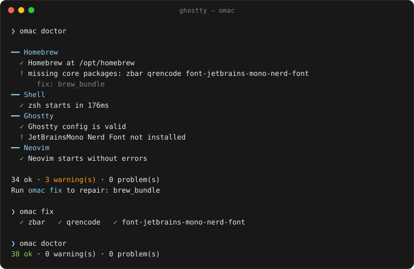
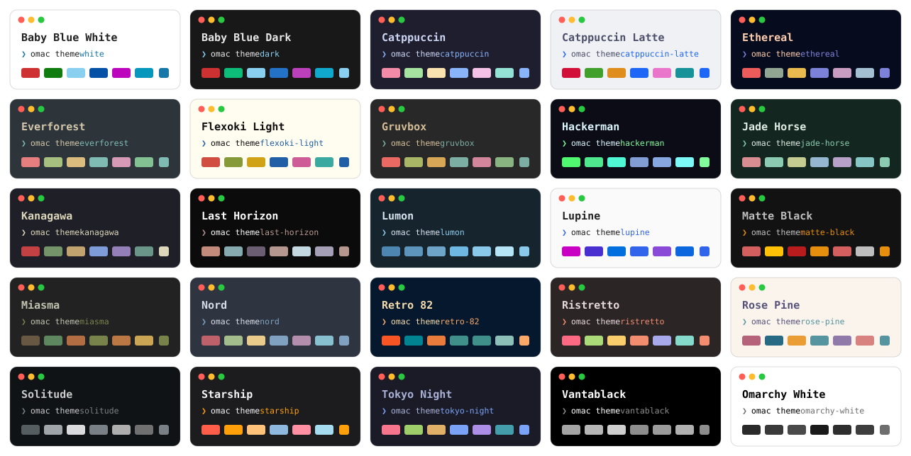

<div align="center">

# omac

### Omarchy for macOS

The terminal, tools, keybindings and all 25 themes from DHH's [Omarchy](https://github.com/basecamp/omarchy), set up on your Mac with one command. Then `omac doctor` keeps it healthy.

[](#install)
[](#themes)
[](https://github.com/basecamp/omarchy)
[](LICENSE)
[](https://github.com/Yolooo332/omac/stargazers)

```sh
bash -c "$(curl -fsSL https://raw.githubusercontent.com/Yolooo332/omac/main/install.sh)"
```



</div>

## Why omac

Omarchy makes a Linux desktop feel fast and beautiful out of the box. omac brings the same terminal-first setup to macOS. You don't need to switch OS or spend a weekend hand-copying dotfiles.

- **One command.** Homebrew, Ghostty, zsh, starship, Neovim (LazyVim), tmux, herdr, lazygit, btop, mise and Raycast, all configured the way Omarchy does it.
- **25 themes, every app at once.** `omac theme tokyo-night` switches Ghostty, tmux, herdr, starship, btop, lazygit, fzf and Neovim together. The set is all 23 Omarchy themes plus omac's Baby Blue.
- **It never overwrites your configs without asking.** Each file you already have gets the choice: replace (with a backup), skip, or see a diff. You can restore any backup with one command.
- **A doctor that fixes things.** `omac doctor` finds duplicate installs, broken configs, slow shell startup and keyboard shortcuts that collide. `omac fix` repairs them.
- **Built for the Mac.** There's no tiling-manager fight: Raycast handles windows, Option acts as Alt, and Omarchy's hotkeys are mapped to keys that work on macOS.
- **Runs on stock macOS.** It's plain bash 3.2, with no Python, Node or Linux needed.

## Install

On a fresh Mac:

```sh
bash -c "$(curl -fsSL https://raw.githubusercontent.com/Yolooo332/omac/main/install.sh)"
```

The script installs the Xcode Command Line Tools and Homebrew if they're missing, clones omac to `~/.local/share/omac` and runs `omac install`. Or from a clone:

```sh
git clone https://github.com/Yolooo332/omac && cd omac && ./install.sh
```

Then use it day to day:

```sh
omac doctor                  # check for problems and conflicts
omac fix                     # repair them
omac theme pick              # choose a theme (or: omac theme nord)
omac keys                    # keybinding cheat sheet
omac update                  # pull omac, upgrade brew + mise tools, sync Neovim plugins
omac menu                    # everything above in one menu
```

## Themes



```sh
omac theme list              # every theme (* = current)
omac theme pick              # fuzzy picker; also in omac menu and Raycast
omac theme tokyo-night       # "Tokyo Night" works too
omac theme white             # back to Baby Blue White (dark = Baby Blue Dark)
```

One command switches Ghostty, tmux, herdr (CLI and app), starship, btop, lazygit, fzf and Neovim. Neovim loads the theme's own colorscheme plugin (tokyonight, catppuccin, rose-pine, ...) on its next start. For VS Code, `omac theme` tells you which extension to install.

<details>
<summary>Where the themes come from</summary>

- **Baby Blue** (`white`, `dark`) is omac's own theme. `themes/baby-blue/palette.json` is the source of truth. omac adds tmux, lazygit and fzf ports through `themes/omac-ports.py`. After editing the palette, re-run that script and `node themes/baby-blue/scripts/build.mjs`.
- **Omarchy** (`catppuccin`, `tokyo-night`, `gruvbox`, `nord`, `rose-pine`, ...) is every stock Omarchy theme, generated into `themes/omarchy/<name>/` from Omarchy's `colors.toml` by `themes/omarchy-themes.py`. Ghostty, btop and Neovim use Omarchy's own templates, and a theme's own `btop.theme` and `neovim.lua` win when it ships them. Omarchy's `white` theme is called `omarchy-white` here. To pull in newer themes, clone Omarchy and run `python3 -I themes/omarchy-themes.py path/to/omarchy`.

Wallpapers, Hyprland, Waybar and the other Linux-desktop parts of Omarchy themes don't apply on macOS.

</details>

## What you get

| Module | What |
|---|---|
| `brew` | Xcode CLT, Homebrew, Omarchy's base CLI tools (`packages/Brewfile`) |
| `shell` | zsh with Omarchy's aliases and functions, ported from bash (`default/zsh/`) |
| `git` | Omarchy's git defaults in `~/.config/git/config`. Your name and email stay in `~/.gitconfig` |
| `mise` | Omarchy's lazy dev tools and AI agents (claude, codex, opencode, gemini, ...), installed the first time you run them |
| `tools` | starship, lazygit, btop, [try](https://github.com/tobi/try) |
| `terminal` | [Ghostty](https://ghostty.org) with Omarchy's keybinds: Option acts as Alt, Shift+Enter is sent as CSI-u, quick terminal |
| `herdr` | herdr with Omarchy's tmux-style keys |
| `tmux` | Omarchy's tmux.conf (Ctrl+Space prefix) |
| `nvim` | Omarchy's [LazyVim](https://lazyvim.org) setup |
| `wm` | [Raycast](https://raycast.com) for windows, launcher and clipboard history, plus omac script commands to bind hotkeys to |
| `vscode` | the Baby Blue VS Code theme |
| `theme` | Baby Blue **white** (default) or dark, or any of the 23 Omarchy themes, applied to every app above |
| `apps` *(optional)* | Omarchy's default GUI apps: Chrome, 1Password, Obsidian, LocalSend, Signal, Spotify, IINA, ... |
| `extra` *(optional)* | more apps: Helix, Typora, OBS, Steam, Wireshark, ... |
| `macos` *(optional)* | macOS defaults that feel like Omarchy: fast key repeat, Ctrl+Cmd+drag to move windows, Dock autohide |

```sh
omac install                    # default modules
omac install apps macos         # optional ones
omac install --skip wm,vscode   # leave some out
omac install --dry-run          # show what would happen, change nothing
```

## omac doctor

`omac doctor` checks the whole setup and `omac fix` repairs what it can, asking before each fix (`--yes` applies them all).

<details>
<summary>Everything it checks</summary>

- Homebrew and the CLT are present, core packages are installed, and `brew doctor` is clean
- no tool is installed twice (`claude` from npm and from mise, `herdr` from its installer and from brew). It also reports which copy wins on PATH
- `.zshrc` loads omac, no tool is initialized twice, no rc file sources a missing file, there are no oh-my-zsh clashes, completion dirs are secure, plus shell startup time and broken symlinks in `~/.config`
- each config is valid according to its own program: `ghostty +validate-config`, `herdr config check`, tmux, starship, `nvim --headless`
- no file shadows another: `~/.tmux.conf`, a second Ghostty `config` next to `config.ghostty`, or a Ghostty config in `~/Library/Application Support`
- macOS's Ctrl+Space input-source shortcut, which takes the herdr/tmux prefix
- other window tools running next to Raycast window management (AeroSpace, Rectangle, Magnet, yabai, ...)
- every app is on the same theme

If a tool is already in your home folder (from herdr's or mise's own installer, for example), omac keeps that copy and doesn't add a Homebrew duplicate. If a GUI app is already in /Applications, Homebrew adopts it so the install doesn't fail.

</details>

## Your configs are safe

omac never overwrites a file it didn't create without asking first. For each one it offers **[r]eplace** (the old file is backed up), **[s]kip** or **[d]iff**. `--replace` and `--keep` give the same answer for every file, and `omac keep starship nvim` tells omac to leave those configs alone for good.

Backups go to `~/.local/state/omac/backups/<timestamp>/`. To bring one back, run `omac backups`, then `omac restore <id> [path]`. When you replace an old `~/.zshrc`, its machine-specific `export` and `source` lines move to `~/.zshrc.local`.

## Keybindings

omac has no tiling manager and no workspace hotkeys. **Raycast Window Management on Ctrl+Option** moves and resizes windows: Ctrl+Option+Return makes a window almost full screen with 8 px padding, Ctrl+Option+C centers it, and you switch Spaces with a trackpad swipe. Because Ctrl+Option belongs to Raycast, herdr and tmux move between panes with **Ctrl+Shift+arrows** (Omarchy uses Ctrl+Alt+arrows).

omac ships Raycast script commands in `raycast/`: a terminal with herdr or tmux, Neovim, btop, lazydocker, and the omac menu, keys, theme, doctor, fix and update commands. To add them, open Raycast's Settings → Extensions → + → Add Script Directory and pick `~/.local/share/omac/raycast`. Run `omac keys` or see [docs/KEYBINDINGS.md](docs/KEYBINDINGS.md) for the full list.

## How it works

omac follows the same model as Omarchy:

- **Defaults live in the repo** and are sourced, so `omac update` (a git pull) brings improvements: `default/zsh/*`, the themes and the omac CLI. The repo is linked at `~/.local/share/omac`.
- **Your configs are seeded once.** omac copies `config/*` into `~/.config` and marks each copy `omac:seeded`. After that the file is yours to edit. `omac refresh <name>` resets it to the default and keeps a backup.
- **The theme is state.** `omac theme` writes `~/.local/state/omac/theme/`, which Ghostty, tmux, zsh and Neovim include. For apps that can't include files (herdr, starship, btop, lazygit), omac rewrites only their theme section.

## FAQ

**Is this an official Omarchy project?** No. It's an independent macOS port that credits Omarchy (MIT). Omarchy itself is a Linux distribution built on Arch and Hyprland.

**Do I need Linux or Omarchy installed?** No. omac runs on stock macOS.

**Will it break my existing setup?** It asks before touching any file you made and backs up everything it replaces. Run `omac install --dry-run` first to see the plan.

**Can I install only part of it?** Yes. Name modules (`omac install shell tmux`) or skip some (`--skip wm,vscode`).

**How do I go back to my old config?** Run `omac backups` and then `omac restore <id>`.

## Contributing

omac is young (v0.1), so issues and pull requests are welcome, especially reports from different Macs and setups. Please include the output of `omac doctor` when you report a bug.

If omac makes your Mac feel like Omarchy, **a ⭐ helps other people find it.**

## Credits

[Omarchy](https://github.com/basecamp/omarchy) by DHH and contributors, MIT licensed: omac ports its configs, shell functions, keybindings and themes to macOS. The theme designs belong to their original authors. See [NOTICE.md](NOTICE.md).

## License

MIT, see [LICENSE](LICENSE).
